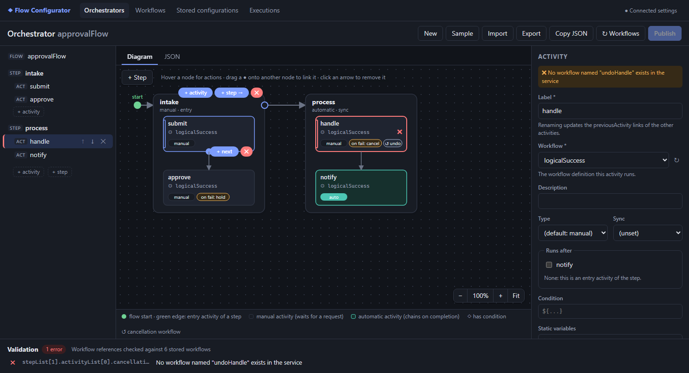

# Flow Configurator

A web app for designing, validating, publishing and monitoring the flows of the
[process-orchestrator](../process-orchestrator) service.

The service runs two kinds of configuration:

- **Orchestrators**: a flow of **steps**, each holding **activities**. Each activity runs a workflow.
- **Workflows**: a sequence of **tasks**, such as HTTP calls, logical checks, notifications, decisions and loops.

Both are stored as JSON versions in the service. Without this app you edit that JSON by hand and only find
mistakes when a flow fails at run time. The Flow Configurator shows each configuration as a diagram you can edit,
and checks it against the rules the engine actually applies.



## What you can do

| Page | Use it to |
|---|---|
| **Orchestrators** | Draw and edit orchestrator flows: steps left to right, activities top to bottom. |
| **Workflows** | Draw and edit workflows: tasks top to bottom, decision cases side by side, loops as boxes. |
| **Stored configurations** | Browse what is stored in the service, see each configuration's active version, start a new version, activate/deactivate/deprecate. |
| **Executions** | Browse the run history, and see how each run went: a coloured diagram, a timeline, and per-run task details with errors and stack traces. |
| **Settings** | Point the app at a service and set the JWT. |

Highlights:

- **Edit on the diagram**: add steps, activities and tasks from the diagram, link them by dragging, drag tasks between
  cases and loops, remove links and nodes. The outline, form inspector and raw JSON stay in sync.
- **Instant validation** with the engine's real rules: entry points, references, cycles, automatic/manual chaining,
  failure policies, task-type requirements, HTTP/notification/map-resolver fields, and **SpEL syntax** in every `${…}`.
- **Reference checks** against the service: every workflow named by an activity, cancellation or sub-workflow must
  exist and have an active version.
- **Task templates** that are valid as soon as they are created.
- **Execution history** tied back to the configuration it ran.

The [User guide](docs/user-guide.md) walks through every screen. The [Validation rules](docs/validation-rules.md)
reference lists every check, and the backend code each one comes from.

## Quick start

Prerequisites: Node.js 22+ (24 is used here), npm, and a running process-orchestrator service.

```bash
npm install
npm start                  # http://localhost:4300
```

`npm start` runs the Angular dev server. It proxies `/api` and `/management` to
`http://localhost:8081/process-orchestrator/...` (see `proxy.conf.json`), so the browser never needs CORS.

Then open **Settings**, paste a JWT, and click **Save and test**. You can edit and validate without a connection.
Reference checks, stored configurations, executions and publishing need one.

> In development builds, a token signed with the service's development secret is filled in for you. It is read
> from `src/environments/environment.development.ts`. That file is git-ignored, so create it from
> `environment.ts` if it is missing. Production builds never contain a token.

### Running the service locally

```bash
cd ../process-orchestrator
JAVA_HOME=~/.jdks/ms-21.0.12 ./mvnw -o       # Java 21+ is required; the default Java 17 is rejected
```

The service listens on **port 8081** under the **`/process-orchestrator`** context path. Other local services (for
example workflow-manager) also default to port 8081. If something else holds the port, the UI gets `404`s from the
wrong application.

## Commands

| Command | What it does |
|---|---|
| `npm start` | Dev server on port 4300, with the API proxy and live reload. |
| `npm test` | Unit tests (Vitest): validators, SpEL parser, layouts, moves, execution mapping. |
| `npm run build` | Production build into `dist/process-orchestrator-ui/browser`. |
| `npx ng build --configuration development` | Fast type-check and build. |

## Configuration

| Where | Setting |
|---|---|
| Settings page | **Service base URL**: empty means "same origin" (the dev proxy). A direct URL needs CORS enabled on the service (`jhipster.cors`). A Docker deployment sets the connection instead (see Docker). |
| Settings page | **JWT**: sent as `Authorization: Bearer …` and stored in the browser only. |
| `proxy.conf.json` | Dev-proxy target and the context-path rewrite. |
| `src/environments/` | `environment.development.ts` holds the development token, used only by `npm start`. |

Things the app remembers in the browser (`localStorage`):

- the open orchestrator and workflow drafts (`po-ui.draft.*`);
- the connection settings (`po-ui.settings`);
- the side-panel widths (`po-ui.panels`).

## Docker

The image builds the production bundle and serves it with nginx. nginx proxies `/api` and `/management` to the
service and adds the token to every call, so the service URL and token are set when you deploy, not in the browser.
The token never reaches the browser, and the **Connection** page only shows where requests go.

| Variable | Required | Meaning |
|---|---|---|
| `PO_BACKEND_URL` | yes | The service, with its context path, e.g. `http://process-orchestrator:8081/process-orchestrator` |
| `PO_TOKEN` | yes | The JWT, without `Bearer `. nginx sends it as `Authorization: Bearer <token>` |
| `APP_BASE_PATH` | no | The path a portal serves the app under, e.g. `/flows/` (default `/`) |
| `APP_LINKS` | no | The portal's apps for the top bar: `Name=url` separated by `;` |

The container stops at startup, with a message, if a required one is missing or a value is malformed.

```bash
docker build -t process-orchestrator-ui .
docker run -d -p 8090:80 \
  -e PO_BACKEND_URL=http://process-orchestrator:8081/process-orchestrator \
  -e PO_TOKEN=eyJhbGciOi... \
  process-orchestrator-ui                 # http://localhost:8090
```

Or with Compose: put `PO_TOKEN=...` (and optionally `PO_BACKEND_URL=...`) in a `.env` file, which is git-ignored,
then run `docker compose up -d --build`. By default, Compose points at a service on the host
(`host.docker.internal:8081`). Anyone who can open the app can use the service with that token's roles, so put
access control in front of it if it is reachable beyond a trusted network. `GET /healthz` is the container's
health check.

Without the Docker config (`npm start`, or the bundle on any other static host), the app works as before: you set
the URL and token on the Connection page. A direct service URL needs CORS enabled on the service (`jhipster.cors`).

### Together with the Workflow Configurator

This app is a micro frontend of the [configurator portal](../configurator-portal). The portal serves it under
`/flows/` and the Workflow Configurator under `/workflows/`, with links between the two in the top bar. Each app
keeps its own image, service and token. `docker compose up -d --build --wait` at the repository root builds and
starts all three images. See the [root README](../README.md) for deploying them elsewhere.

## Documentation

- [User guide](docs/user-guide.md): every screen and interaction.
- [Validation rules](docs/validation-rules.md): every check, why it exists, and its source in the backend.
- [Architecture](docs/architecture.md): code layout, data flow, and how to add a rule, task template or component.
- [CLAUDE.md](CLAUDE.md): working notes for AI-assisted development (commands, conventions, gotchas).
