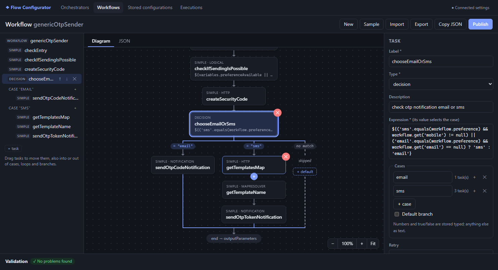
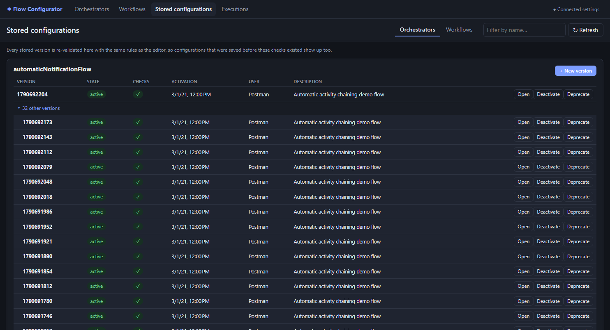
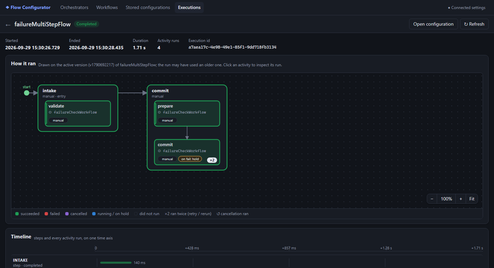

# User guide

This guide covers every screen of the Flow Configurator. For setup and running, see the [README](../README.md).

- [Concepts](#concepts)
- [The editor layout](#the-editor-layout)
- [Orchestrator editor](#orchestrator-editor)
- [Workflow editor](#workflow-editor)
- [Validation](#validation)
- [Publishing a version](#publishing-a-version)
- [Stored configurations](#stored-configurations)
- [Executions](#executions)
- [Settings](#settings)
- [Keyboard and mouse reference](#keyboard-and-mouse-reference)

---

## Concepts

**Orchestrator** (`/api/v1/orchestrator`)
: A flow, made of steps. The service starts it by its `label`.

**Step**
: A stage of the flow. A step runs **after** the steps listed in its `previousStep`. The flow starts at the first
  step that has no `previousStep`.

**Activity**
: A unit of work inside a step. It runs a **workflow** (`workflowLabel`). An activity runs after the activities
  listed in its `previousActivity`. A step starts at its first activity without `previousActivity`.

**Manual / automatic**
: A **manual** step or activity waits for a request before it runs. An **automatic** one starts by itself as soon as
  its predecessor completes. Automatic ones chain **1 to 1**: exactly one predecessor, and they must be that
  predecessor's only successor. Manual ones may have several paths in and out.

**Workflow** (`/api/v1/workflow`)
: A sequence of **tasks**, run top to bottom.

**Task**
: One action. Its `type` decides how it runs: `simple` (calls a component such as `http`, `logical`, `notification`
  or `mapResolver`), `decision` (one case runs), `for` (loop), `subFlow` (another workflow), `manual`, `terminate`,
  `validate`, `logical`.

**Version**
: Every save creates a new numbered version. The engine runs the **active**, non-deprecated version.

---

## The editor layout

Both editors share the same layout.

```
┌──────────────┬────────────────────────────────────┬──────────────────┐
│  Outline     │  Diagram  |  JSON                  │  Inspector       │
│  (tree)      │                                    │  (form for the   │
│              │                                    │   selected item) │
├──────────────┴────────────────────────────────────┴──────────────────┤
│  Validation: errors / warnings / notes  (click one to jump to it)    │
└──────────────────────────────────────────────────────────────────────┘
```

- **Outline**: the structure as a tree. Click to select. Hover a row for ↑ ↓ ✕. In the workflow outline you can
  **drag rows** to move tasks, also into and out of cases and loops.
- **Diagram**: the visual flow. You can edit on it directly (see below). The zoom bar in the bottom-right corner
  has − / % / + / **Fit**. **Ctrl + mouse wheel** zooms, and dragging the empty background pans.
- **JSON**: the raw document. Edits apply as soon as the text is valid JSON. A parse error shows the line and
  column, and the other views keep the last valid version.
- **Inspector**: a form for the selected flow, step, activity or task. Fields grow with their content.
- **Validation panel**: every problem, with its location. Click one to select the item it belongs to.

**Resizing panels**: drag the edge between a side panel and the diagram. The edge highlights blue when you hover
it. Double-click it to reset. Widths are remembered, and both editors share them.

**Toolbar**: *New* (empty document) · *Sample* · *Closed tabs* · *Import* (a `.json` file, either a bare definition
or a full create request) · *Export* · *Copy JSON* · *Publish*. New, Sample and Import open in a new tab.

### Tabs

Each open document has a tab above the toolbar, so you can work on several at once. Click a tab to switch to it.
Each tab keeps its own undo history and selection. **+** opens a new document. **✕** (or a middle click) closes a
tab without asking: it goes to **Closed tabs** in the toolbar, which reopens it (the newest 20 are kept). Closing
the last tab leaves a new one. New, Sample, Import, and opening a stored version or a run's configuration each open in a
new tab; if that exact document is already open, its tab is shown instead.

Your tabs are kept in the browser, so a reload reopens them. They are kept per browser: two browser windows on the
same editor overwrite each other's tabs, so edit in one window.

---

## Orchestrator editor


### Reading the diagram

- **Steps** are large boxes, left to right. Long flows **wrap onto new rows**, connected by a rounded line.
- **Activities** are the boxes inside a step, top to bottom.
- The **green dot** marks the flow's start. A **green bar** on an activity's left edge marks the step's entry
  activity.
- **Teal boxes** are automatic activities; dark boxes are manual.
- Tags on an activity: `auto`/`manual`, `on fail: …`, `↺ undo` (it has a cancellation workflow). `◇` means it has a
  condition.
- **Arrows** show "runs after". When a step or activity has several predecessors, each arrow enters at its own
  point, and the header says *after X or Y*.
- A **red or amber outline** with ✖ / ▲ means the box has a validation error or warning.

### Editing on the diagram

| To | Do |
|---|---|
| Add a step at the end | **+ Step** (top-left of the diagram) |
| Add a step that runs after another | hover the step → **+ step →** |
| Add an activity to a step | hover the step → **+ activity** |
| Add an activity that runs after another | hover the activity → **+ next** |
| Delete a step or activity | hover it → **✕** |
| Make B run after A | hover A, then drag its **●** (on the step's right edge, or the activity's bottom edge) onto B |
| Remove a link | click the arrow → **✕ remove link** (or press Delete) |

When you rename a step or activity, the `previous…` links that point to it are renamed too. When you delete one,
the nodes after it are reconnected to the nodes before it.

### The inspector

- **Flow**: label, static variables.
- **Step**: label, type (manual/automatic), sync, and **Runs after** (checkboxes of the other steps).
- **Activity**:
  - label;
  - **Workflow** (a dropdown of the workflows stored in the service, with ↻ to reload the list);
  - description, type, sync;
  - **Runs after**, condition, static variables;
  - **On failure**:
    - `fail`: the flow ends FAILED;
    - `hold`: the flow waits ON_HOLD for a retry, rerun, skip or cancel. Optionally a **hold timeout** (ISO-8601
      duration such as `PT24H`, counted from the last failure) and what happens **on timeout**: `fail` (default) or
      `cancel` (runs the cancellation workflow, failing the flow if it cannot run). The service applies it when the
      scheduler manager runs its `orchestratorHoldTimeout` job. While an operation acts on a held flow it is
      RECOVERING; if that operation never finishes (e.g. its instance stopped), the `orchestratorStaleRecovering` job
      puts the flow back ON_HOLD once it has been RECOVERING with no change for longer than `staleAfter` (default
      `PT30M`, keep it above the slowest workflow);
    - `cancel`: runs the cancellation workflow;
  - **Cancellation activity**: its workflow, active, run automatically on failure, its static variables.

---

## Workflow editor



### Reading the diagram

- Tasks run **top to bottom** from *start* to *end → outputParameters*. Each box shows its type and component, its
  label, and its expression, URL or flow name.
- A **decision** splits into **side-by-side columns**, one per case (`= "value"`), plus `default`. When there is no
  default, a dashed **no match** column shows that nothing runs when no case matches. All columns rejoin below.
- A **for** loop is a dashed box: *↻ for each in `list`*.

### Editing on the diagram

| To | Do |
|---|---|
| Insert a task after another | hover the task → **+** under it → pick a template |
| Add the first task of a case or loop | **+ add** in the empty column |
| Give a decision a default | **+ default** in its *no match* column (or drop a task onto it) |
| Delete a task | hover it → **✕** |
| Move a task | drag it: drop on the **top half** of another task to put it before, the **bottom half** to put it after, or onto an empty case or loop |

A task cannot be dropped inside itself. For example, a decision cannot go into one of its own cases.

### Task templates

Every "add task" menu offers templates that pass validation as created. Fields only you can fill (a recipient, a
template id, a target workflow) are left empty and flagged.

| Template | Creates |
|---|---|
| Logical check | `simple` + `logical` with an `expression` |
| HTTP call | `simple` + `http`: `inputParameters.{url, httpMethod, headers, body}`, `successCondition` |
| Email notification | `simple` + `notification` (`email`): sender, recipients, subject, template id |
| SMS notification | `simple` + `notification` (`sms`): phone number, template id |
| Map resolver | `simple` + `mapResolver`: `keys` (`key1`, `key2`, …) and a nested `map` with `DEFAULT` fallbacks |
| Decision | `decision` with an `expression` and two cases |
| For each | `for` with a `list` expression and one loop task |
| Sub-workflow | `subFlow` with `flowName` and `inputParameters` |
| Manual / Terminate | `manual` / `terminate` |

### The inspector

Common fields (label, type, description, retry, failure output parameters) plus fields for each type:

- **Component** dropdown for `simple` tasks. Switching to `http` or `logical` fills in the fields it needs.
- **HTTP request** with a **URL / Configured route** switch:
  - **URL**: method, URL, headers, body;
  - **Configured route**: `inputParameters.endpoint`, the name of a route in `workflowengine.endpoints.routes`;
  - both: success condition, raw request.
- **Notification**: type, template id, system and client, then From / To (one per line) / Subject for email, or
  Phone / Gateway for SMS. Content.
- **Map resolver**: keys, plus the map either **inline** or as a **`${…}` expression**.
- **Decision**: cases (the key is stored as a number or true/false when it looks like one), default on or off.
- **For**: list and optional condition. Each run gets the current element as `listMember`.
- **Sub-workflow**: the target workflow (dropdown) and input parameters.
- **Raw task JSON** (collapsed) for any field the form does not cover.

Logical tasks have no **Retry** field: re-evaluating the same expression gives the same result.

---

## Validation

Problems are checked on every change, with three levels:

- **✖ Error**: the service rejects it, or the flow cannot run. **Publish is disabled** while there are errors.
- **▲ Warning**: allowed, but almost certainly a mistake.
- **i Note**: worth knowing, for example "this decision has no default".

Every rule, why it exists, and where it comes from in the backend is listed in
[Validation rules](validation-rules.md).

When connected, workflow references are also checked against the service. The panel says when they could not be
checked (not connected).

---

## Publishing a version

**Publish** opens a dialog for the version details:

- **Version**: the next free number is suggested, and a number that already exists is refused.
- **Schema version**, user, activation date, description, **Active**.

The app sends `POST /api/v1/{orchestrator|workflow}/create` with `{ …Configuration, configurationDetails }`. If the
service rejects the request, its error messages are shown in the dialog.

---

## Stored configurations



- Choose **Orchestrators** or **Workflows**, and filter by name.
- Each configuration shows its **active version**. The others are under **▸ N other versions**.
- Every version is re-validated with the current rules (✖ / ▲ counts), so older versions that break today's rules
  stand out.
- **Open** loads a version into the editor. **+ New version** opens the active version (or else the newest) as the
  base of a new one. **Activate / Deactivate / Deprecate** change its state. Deprecating cannot be undone.

---

## Executions



### The list

Every flow run, newest first, 25 per page. You can filter by **status** (several at once), **flow name** and
**execution id**. Durations of running flows count up to now.

### An execution

1. **How it ran**: the flow's diagram, coloured by outcome:

   | Colour / mark | Meaning |
   |---|---|
   | green | succeeded |
   | red | failed |
   | purple | cancelled |
   | blue, dashed | running or on hold |
   | faded | did not run |
   | `×2` | ran twice (a retry or rerun) |
   | `↺` | its cancellation workflow ran |

   Click an activity to inspect its latest run.

2. **Timeline**: steps and every activity run on one time axis, with durations. Retries are separate bars.

3. **Run inspector**: for the selected run:
   - its workflow execution: status, a timing bar per task, and the **error** with the failing task;
   - the full **stack trace** (collapsed);
   - workflow outputs and inputs, and the activity request and response.

> The traces do not record which configuration version ran. The diagram uses the **active** version (or else the
> newest), says so, and lists any runs it cannot place. Task executions are cleaned up after some time. When they
> are gone, a note says so.

---

## Settings

- **Service base URL**: leave empty to use the dev proxy.
- **JWT**: sent as `Authorization: Bearer …`.
- **Save and test** reports how many workflows were found, or the error.

---

## Keyboard and mouse reference

| Where | Input | Action |
|---|---|---|
| Diagrams | Ctrl + wheel | zoom |
| Diagrams | drag on the background | pan |
| Orchestrator diagram | Delete | remove the selected link |
| Orchestrator diagram | Esc | cancel a link drag / clear the selected link |
| Template menus | Esc | close |
| Panel edges | drag / ← → / double-click | resize / nudge / reset |
| URL, condition and similar fields | Enter | ignored (the value stays on one line) |
| JSON tab | Tab | inserts two spaces |
